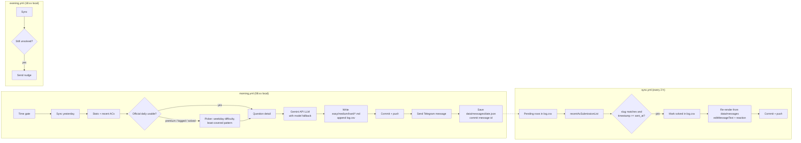

# LeetCode Daily Bot

A serverless GitHub Actions bot. Every morning it picks one LeetCode problem with no repeats, commits an AI-generated solution, and sends Dheepak a Telegram message with the problem, LeetCode stats and a hint. During the day it watches the public LeetCode profile and edits that message to "Solved" once an accepted submission shows up. In the evening it sends a nudge if the problem is still open.

## How it works



- **`log.csv`** is the single source of truth: one row per issued problem.
- The official daily problem is used unless it's premium, already logged or already solved recently. Otherwise a deterministic picker chooses one by weekday difficulty, least-covered core pattern and acceptance rate.
- The solution language rotates in blocks of 10 days: C++, Python, Java, Java, Python, C++, then repeats.
- Edits re-render the original message from its saved context through the same renderer. Text is never patched with string surgery.

## Setup

1. **Telegram:**
   1. Message [@BotFather](https://t.me/BotFather), send `/newbot`, and copy the token.
   2. Open your new bot and send it `/start`.
   3. Visit `https://api.telegram.org/bot<TOKEN>/getUpdates` and copy `message.chat.id`.
2. **Gemini:** sign in at [aistudio.google.com/apikey](https://aistudio.google.com/apikey) and create a free API key (no credit card needed).
3. **GitHub repo → Settings → Secrets and variables → Actions:**
   - Secrets: `TELEGRAM_BOT_TOKEN`, `TELEGRAM_CHAT_ID`, `GEMINI_API_KEY`.
   - Variables: `LEETCODE_USERNAME` = `___ka__ran___`.
4. **GitHub repo → Settings → Actions → General:** set Workflow permissions to "Read and write".
5. **Locally:** run `python -m src.preview` with the env vars set, and check every variant on your phone.
6. **Actions tab:** run `morning` manually with `force=true` once. Confirm the commit, the Telegram message, and the solution link.
7. **Solve the problem on LeetCode,** then run `sync` manually. Confirm the message edits to "Solved".
8. **Done.** From here it runs daily on its own. If GitHub ever emails that scheduled workflows were disabled for inactivity, re-enable them in the Actions tab.

Solutions are written by Google's Gemini API on its free tier, called through Gemini's OpenAI-compatible endpoint. The bot makes one request a day, far below the free limits. (The original design used GitHub Models, which GitHub shut down on July 30, 2026.)

## Configuration

All tunables live in [`config.yaml`](config.yaml):

| Key | Meaning |
|---|---|
| `owner_name`, `timezone` | Name used in greetings; local timezone for time gates and displayed times. |
| `schedule.morning_local_hour` | Morning job sends at or after this local hour (the cron fires twice to cover DST). |
| `schedule.evening_local_hour` | Evening nudge only runs during this local hour. |
| `schedule.sync_every_hours` | Informational; the actual cadence is the cron in `sync.yml`. |
| `languages.block_size`, `languages.cycle` | Language rotation: day *n* uses `cycle[((n-1) // block_size) % len(cycle)]`. |
| `picker.difficulty_by_weekday` | Fallback picker's target difficulty per local weekday (Mon=0 … Sun=6). |
| `picker.core_patterns` | Topic tag slugs; the picker targets the one with the fewest log rows. |
| `picker.acrate_ranges` | Preferred acceptance-rate range per difficulty (relaxed if nothing fits). |
| `picker.problems_cache_days` | Max age of `data/problems.json` before it's refreshed. |
| `llm.endpoint`, `llm.models` | OpenAI-compatible chat endpoint (Gemini by default) and model IDs, tried in order. |
| `llm.api_key_env` | Name of the env var / Actions secret holding the API key (`GEMINI_API_KEY`). |
| `llm.temperature`, `llm.max_retries_per_model` | Sampling temperature; retries on 429/5xx per model. |
| `llm.reasoning_effort`, `llm.max_output_tokens` | How much Gemini thinks before answering, and the output budget for thinking plus answer. |
| `milestones.solved_every`, `milestones.streak_days` | When to add a 🎉 line (every N solved, or these streak lengths). |
| `telegram.reaction_on_solve` | Reaction added to the morning message when solved (must be an allowed Telegram reaction). |

Secrets and runtime values come from the environment only: `TELEGRAM_BOT_TOKEN`, `TELEGRAM_CHAT_ID`, `GEMINI_API_KEY`, `LEETCODE_USERNAME`, `GITHUB_REPOSITORY`. Locally, copy `.env.example` to `.env`.

## Manual runs and preview

Every workflow has a **Run workflow** button with two checkboxes:

- `dry_run`: print the messages in the job log. No Telegram, no git, no file changes.
- `force`: skip time gating and idempotency checks. For `morning` this issues a new problem even if one was already sent today.

If a morning message says *"Solution unavailable today. Rerun from Actions."*, rerun `morning`. It retries the LLM for the same problem and edits the message. You don't need `force` for this.

Locally:

```bash
python -m venv .venv && source .venv/bin/activate
pip install -r requirements.txt
python scripts/smoke_leetcode.py                  # live API check
python -m src.morning --dry-run --force           # full run, prints message, no send/commit
python -m src.preview                             # sends every variant (needs Telegram env vars)
python -m src.preview --dry-run                   # prints every variant instead
pytest -q
```

`preview` sends normal, missed, Sunday, no-solution and milestone samples. It also sends one message and edits it into the solved state, then sends an evening nudge. It never touches `log.csv`, data files or git.

## Development workflow

- `main` is always deployable. Work happens on short-lived branches (`feat/…`, `fix/…`, `docs/…`, `ci/…`) using [Conventional Commits](https://www.conventionalcommits.org/).
- Open a pull request into `main`. The `ci` workflow runs `pytest -q` on Python 3.12 and must pass before merging.
- Use **Create a merge commit** when merging, then delete the branch.
- The bot's own jobs commit data (`log.csv`, `data/`, solutions, README progress) straight to `main` as `github-actions[bot]`. If you add branch protection, don't require pull requests for those pushes, or the scheduled jobs will fail.

## Repo layout

```
.github/workflows/   morning.yml · sync.yml · evening.yml · ci.yml (tests on PRs)
src/                 config, LeetCode client + queries, picker, languages, llm,
                     solution_writer, stats, messages, telegram_client, log_store,
                     git_ops, readme_progress, runtime, and the entry points
                     morning / sync / evening / preview
scripts/             smoke_leetcode.py (live check of every query)
data/                problems.json (weekly cache) · stats_history.json ·
                     greetings.json · messages/{date}.json (render contexts)
easy/ medium/ hard/  generated solutions: {id:04d}-{slug}.md
tests/               pytest suite (no network)
config.yaml · log.csv · DECISIONS.md
```

## Copyright

Problem statements belong to LeetCode. This repo stores only problem links, metadata (titles, difficulty, tags) and AI-generated solutions. The statement text is fetched at run time for the LLM prompt and is never written to disk. Solutions are AI-generated and unverified.

<!-- PROGRESS:START -->

## Progress

_No problems issued yet. The first one arrives with the next morning run._

<!-- PROGRESS:END -->
